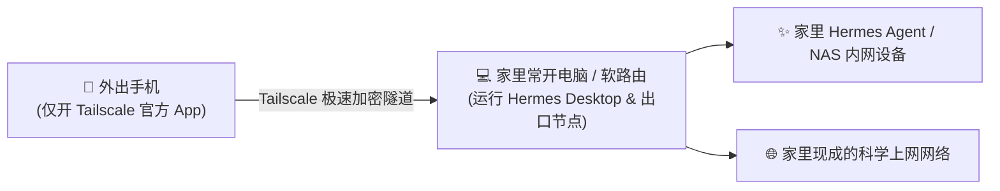

# 🚀 Hermes Tailscale 出口节点方案：手机免装代理、一键无感出海

> **核心特性**：**手机端零配置、免装 Clash、免碰任何 YAML 文件**！  
> 手机仅需安装一个官方 Tailscale App，连回家里常开的电脑/软路由，即可实现「在外随时直连家里 Hermes Agent」与「无感透明出海科学上网」二合一。

---

## 🌟 方案核心优势：极简无缝

传统方案往往需要手机端折腾复杂的代理软件、配置规则或申请公网 IPv6。而**出口节点方案（Exit Node）**彻底简化了这种逻辑：



1. **手机端极度纯净**：手机只需从应用商店下载一个 Tailscale 官方 App，不需要装任何第三方代理，不需要接触任何复杂配置；
2. **免公网 IP / 免 IPv6**：利用 Tailscale 的全锥形 NAT 打洞技术，家里无需公网 IP，两端自动握手；
3. **回家＝全自动透明翻墙**：人在外面，只要打开 Tailscale 开关，所有流量自动借道家里，既能看家里的 Hermes，又能直接上 Google / ChatGPT！

---

## 🛠️ 第一步：家里电脑端设置（以 Windows 为例）

家里电脑正常运行 **Hermes Desktop / Agent**，并按以下步骤开启出口节点：

### 1. 声明电脑为出口节点（Exit Node）
运行以下命令让这台电脑向你的 Tailscale 私有网广播出口能力：
```powershell
& "C:\Program Files\Tailscale\tailscale.exe" up --advertise-exit-node --unattended
```
*(注：`--unattended` 保证在电脑锁屏或睡眠唤醒时后台持续稳定运行，无需更改注册表)*

### 2. 网页后台批准出口节点（关键一步）
1. 打开浏览器进入 Tailscale 控制台：[login.tailscale.com/admin/machines](https://login.tailscale.com/admin/machines)；
2. 找到你的电脑设备名称；
3. 点击右侧的 **`...`**（三个点），选择 **`Edit route settings...`**；
4. 勾选 **`Use as exit node`**（允许作为出口节点）并保存。

### 3. 路由器开启 UPnP（保障 4G/5G 满速直连）
* 登录家里路由器后台，找到 **UPnP 设置** 并确保**开启**；
* *（这能确保手机在外部使用移动蜂窝流量时，能与家里电脑瞬间建立 P2P 直连打洞，避免掉入 600ms 的拥堵中继）。*

---

## 📱 第二步：手机端使用指引（仅需 30 秒）

1. 手机下载安装官方 **Tailscale App**；
2. 登录与电脑**完全相同的账号**（支持 Apple / Google / GitHub 等一键登录）；
3. 在 App 主界面的 **`Exit Node`** 选项中，选中家里这台电脑；
4. 点击顶部的大开关连接！

👉 **此时你的手机已经像坐在家里一样：**
* 浏览器访问 `http://<电脑Tailscale内网IP>:<端口>` 直接使用家里的 **Hermes AI Agent**；
* 手机刷网页、看 YouTube、使用 ChatGPT 自动顺着家里网络高速出海，**手机上无需再挂任何其他翻墙客户端**！

---

## 🤖 附：让其他 AI 帮配置的专属 Prompt（一键复制）

可以直接将以下提示词发送给 ChatGPT / Claude / Cursor，让 AI 自动化协助配置家里电脑：

```markdown
# 任务目标：配置本地电脑为 Tailscale 出口节点（实现手机免装代理、一键透明翻墙）

## 一、方案核心场景
用户在外面的手机上**不安装、不运行任何代理软件（无需 Clash，无 YAML 文件）**，仅运行一个官方 Tailscale App。
家里的常开电脑（Windows/Linux/Mac）已具备正常科学上网能力。
目标：将家里电脑配置为 Tailscale 出口节点（Exit Node），手机在外只需连上 Tailscale，即可无感访问家里内网（如 Hermes Agent），并直接复用家里电脑的网络透明出海。

---

## 二、执行指令（请协助用户在家里电脑上完成）

1. **一键开启电脑的出口节点广播**：
   - Windows/Linux 命令行运行：
     `tailscale up --advertise-exit-node --unattended`
2. **后台批准出口节点（网页端一键操作）**：
   - 提醒用户打开 Tailscale 控制台（https://login.tailscale.com/admin/machines）；
   - 找到当前电脑 -> 点击 `...` -> `Edit route settings` -> 勾选 `Use as exit node` 并保存。
3. **路由器 NAT 穿透建议**：
   - 提醒用户在家里路由器后台开启 **UPnP**（或映射 UDP 41641），确保手机在外部 4G/5G 蜂窝网络下能秒级穿透直连电脑，不卡顿、不走中继。

---

## 三、手机端使用指引（极简零门槛）
- 手机仅需安装 Tailscale App 并登录同一账号；
- 在 App 的 `Exit Node` 中选择家里这台电脑；
- 点击连接后，手机无需任何其他设置，自动实现内网直连 + 透明出海。
```

---

## 📄 License
MIT © 2026. 欢迎自由 Fork 与交流！
